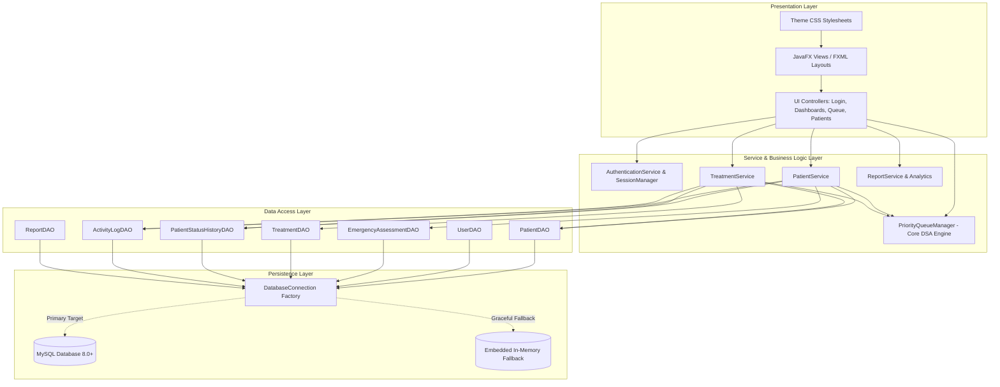
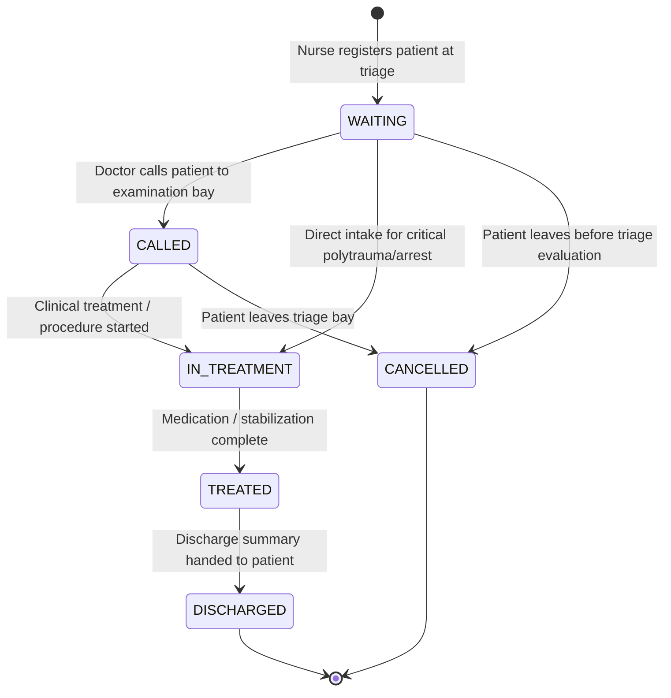

# System Architecture Document

## Hospital Emergency Patient Priority Management System (HE-PPMS)

### 1. High-Level Architecture Overview

The **Hospital Emergency Patient Priority Management System** follows a clean, decoupled **Layered MVC (Model-View-Controller) + Service + Data Access Object (DAO)** architectural pattern.

---

### 2. Architectural Layers

#### A. Presentation Layer (JavaFX / FXML / CSS)
- **Decoupled Declarative Views**: User interfaces are designed in modular FXML files with separation of layout and presentation styles.
- **Role-Adaptive Layout (`MainLayout.fxml`)**: A shell hosting a responsive left sidebar, header with live clock, and a dynamic content `StackPane`. Menu items and operations dynamically adapt based on whether the logged-in user is an **Admin**, **Doctor**, or **Nurse**.
- **Modern Healthcare Theme (`main.css`)**: Professional clinical color palette featuring dedicated triage severity indicators (Critical Red, High Orange, Medium Amber, Low Green), rounded cards, clean data tables, and in-app non-blocking alert toasts.

#### B. Controller Layer
- **`BaseController`**: Common abstract base class providing access to parent layout navigation, session status, time formatters, and style badge helpers.
- **Controllers**:
  - `LoginController`: Authenticates credentials against the database, validates non-empty inputs, verifies selected roles, and controls session bootstrap.
  - `AdminDashboardController`: Aggregates real-time statistics and renders interactive JavaFX charts (`PieChart`, `BarChart`).
  - `DoctorDashboardController`: Displays department KPIs and features the **NEXT PATIENT** triage card driven by the Priority Queue.
  - `NurseDashboardController`: Triage workstation with quick patient registration shortcuts and live queue preview.
  - `PatientRegistrationController`: Validates patient demographics, captures symptoms, assesses severity level, generates unique tokens, and automatically enqueues patients.
  - `LiveQueueController`: Real-time queue table with dynamic sorting, search, severity filters, and wait-time threshold alerts.
  - `PatientManagementController`: Directory table with multi-parameter filtering and full profile inspection.
  - `PatientDetailController`: Comprehensive patient timeline showing demographics, triage notes, treatments, and audit transitions.
  - `TreatmentController`: Dedicated doctor workstation for recording medications, procedures, completion, and discharge.
  - `ReportsController`: Analytical reporting engine with multi-report generation and CSV export.
  - `ActivityLogsController`: Immutable audit log inspector.
  - `UserManagementController`: Administrative staff CRUD and role assignments.
  - `SettingsController`: Operational configuration for overdue thresholds and refresh cadence.
  - `AboutController`: System specifications and medical disclaimer.

#### C. Service & Business Logic Layer
- **`PriorityQueueManager` (Core DSA)**:
  - Manages the emergency queue using strict multi-tier comparison:
    1. **Primary Sort**: Emergency Level (`1 = CRITICAL`, `2 = HIGH`, `3 = MEDIUM`, `4 = LOW`).
    2. **Secondary Sort**: Arrival Timestamp (earliest arrival first).
    3. **Tie-Breaker**: Deterministic patient identifier.
  - Re-heaps dynamically when new patients arrive, severity is re-assessed, treatment starts, or discharge occurs.
- **`PatientService`**:
  - Enforces field validation rules (name, age range, valid phone, non-empty symptoms).
  - Handles the patient status workflow state machine.
- **`TreatmentService`**:
  - Manages clinical intervention lifecycles (`IN_PROGRESS` -> `COMPLETED` -> `DISCHARGED`).
- **`AuthenticationService` & `SessionManager`**:
  - Verifies BCrypt salted hashes and enforces Role-Based Access Control (RBAC).

#### D. Data Access Object (DAO) Layer
- Uses standard **JDBC `PreparedStatement`** for 100% parameterization against SQL injection vulnerabilities.
- Handles clean connection lifecycles via `try-with-resources`.
- Translates relational rows into rich object graphs.

#### E. Persistence Layer & Dual-Mode Connectivity
- **Primary**: MySQL Server 8.0+ via `mysql-connector-j`.
- **Graceful Fallback**: If MySQL is offline or during automated unit testing, `DatabaseConnection` automatically detects connectivity failure and boots an embedded H2 database in MySQL compatibility mode, executing `schema.sql` and `sample_data.sql` seamlessly.

---

### 3. Patient Workflow State Machine

---

### 4. Priority Queue Time Complexity Analysis

| Operation | Description | Time Complexity |
| :--- | :--- | :--- |
| **`enqueue(Patient)`** | Inserts patient into priority queue and reorders positions | $O(n \log n)$ / $O(\log n)$ |
| **`peek()`** | Inspects highest-priority patient at head of queue (Doctor "Next Patient") | $O(1)$ |
| **`dequeue()`** | Removes top patient when treatment commences | $O(1)$ |
| **`remove(patientId)`** | Removes patient when discharged or admitted to surgery | $O(n)$ |
| **`filter(...)`** | Searches and filters queue by severity/status/keyword | $O(n)$ |
