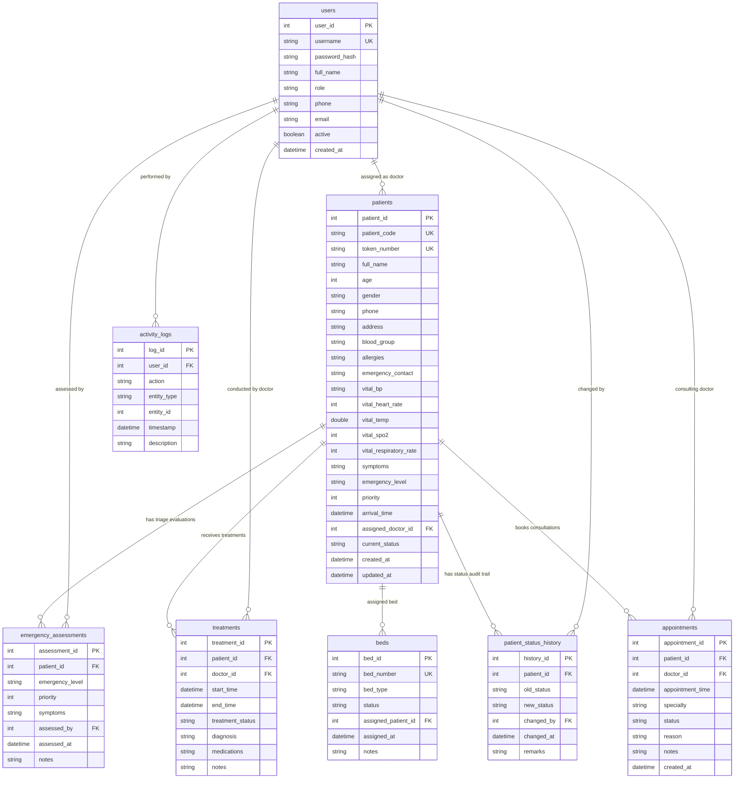

# Relational Database Design Document

## Hospital Emergency Patient Priority Management System (HE-PPMS)

### 1. Database Specifications
- **Database Engine**: MySQL 8.0+ (InnoDB Storage Engine)
- **Embedded Fallback Engine**: H2 In-Memory Database (`MODE=MySQL`)
- **Character Set**: `utf8mb4`
- **Collation**: `utf8mb4_unicode_ci`
- **Default Database Name**: `hospital_emergency_system`
- **Normalization Level**: Third Normal Form (3NF)

---

### 2. Entity-Relationship Diagram (ERD)

---

### 3. Detailed Table Schema Definitions

#### 3.1 `users`
Stores authenticated user accounts for staff and patients with BCrypt-hashed passwords.
- `user_id` (INT, PK, AUTO_INCREMENT)
- `username` (VARCHAR(50), UNIQUE, NOT NULL)
- `password_hash` (VARCHAR(255), NOT NULL)
- `full_name` (VARCHAR(100), NOT NULL)
- `role` (VARCHAR(20), NOT NULL) - Enum: `ADMIN`, `DOCTOR`, `NURSE`, `PATIENT`
- `phone` (VARCHAR(20))
- `email` (VARCHAR(100))
- `active` (BOOLEAN, DEFAULT TRUE)
- `created_at` (DATETIME, DEFAULT CURRENT_TIMESTAMP)

#### 3.2 `patients`
Emergency patients intake records, clinical vitals, triage classification, and current status.
- `patient_id` (INT, PK, AUTO_INCREMENT)
- `patient_code` (VARCHAR(20), UNIQUE, NOT NULL)
- `token_number` (VARCHAR(20), UNIQUE, NOT NULL)
- `full_name` (VARCHAR(100), NOT NULL)
- `age` (INT, NOT NULL)
- `gender` (VARCHAR(10), NOT NULL)
- `phone` (VARCHAR(20), NOT NULL)
- `address` (TEXT)
- `blood_group` (VARCHAR(10))
- `allergies` (VARCHAR(255))
- `emergency_contact` (VARCHAR(255))
- `vital_bp` (VARCHAR(20))
- `vital_heart_rate` (INT)
- `vital_temp` (DECIMAL(4,1))
- `vital_spo2` (INT)
- `vital_respiratory_rate` (INT)
- `symptoms` (TEXT, NOT NULL)
- `emergency_level` (VARCHAR(20), NOT NULL) - Enum: `CRITICAL`, `HIGH`, `MEDIUM`, `LOW`
- `priority` (INT, NOT NULL) - 1 (Critical), 2 (High), 3 (Medium), 4 (Low)
- `arrival_time` (DATETIME, NOT NULL)
- `assigned_doctor_id` (INT, FK -> `users.user_id`)
- `current_status` (VARCHAR(20), NOT NULL, DEFAULT 'WAITING')
- `created_at` (DATETIME, DEFAULT CURRENT_TIMESTAMP)
- `updated_at` (DATETIME, DEFAULT CURRENT_TIMESTAMP ON UPDATE CURRENT_TIMESTAMP)

#### 3.3 `beds`
Hospital bed and ward occupancy tracking.
- `bed_id` (INT, PK, AUTO_INCREMENT)
- `bed_number` (VARCHAR(20), UNIQUE, NOT NULL)
- `bed_type` (VARCHAR(30), NOT NULL, DEFAULT 'EMERGENCY') - Enum: `EMERGENCY`, `ICU`, `TRAUMA_BAY`, `OBSERVATION`, `GENERAL_WARD`
- `status` (VARCHAR(20), NOT NULL, DEFAULT 'AVAILABLE') - Enum: `AVAILABLE`, `OCCUPIED`, `RESERVED`, `MAINTENANCE`
- `assigned_patient_id` (INT, FK -> `patients.patient_id`, ON DELETE SET NULL)
- `assigned_at` (DATETIME)
- `notes` (TEXT)

#### 3.4 `appointments`
Outpatient scheduled consultations separated safely from emergency queue workflows.
- `appointment_id` (INT, PK, AUTO_INCREMENT)
- `patient_id` (INT, NOT NULL, FK -> `patients.patient_id`, ON DELETE CASCADE)
- `doctor_id` (INT, NOT NULL, FK -> `users.user_id`, ON DELETE CASCADE)
- `appointment_time` (DATETIME, NOT NULL)
- `specialty` (VARCHAR(100))
- `status` (VARCHAR(20), NOT NULL, DEFAULT 'SCHEDULED') - Enum: `SCHEDULED`, `CONFIRMED`, `COMPLETED`, `CANCELLED`
- `reason` (VARCHAR(255))
- `notes` (TEXT)
- `created_at` (DATETIME, DEFAULT CURRENT_TIMESTAMP)

#### 3.5 `emergency_assessments`
Clinical severity evaluations and audit records.
- `assessment_id` (INT, PK, AUTO_INCREMENT)
- `patient_id` (INT, NOT NULL, FK -> `patients.patient_id`, ON DELETE CASCADE)
- `emergency_level` (VARCHAR(20), NOT NULL)
- `priority` (INT, NOT NULL)
- `symptoms` (TEXT, NOT NULL)
- `assessed_by` (INT, NOT NULL, FK -> `users.user_id`)
- `assessed_at` (DATETIME, DEFAULT CURRENT_TIMESTAMP)
- `notes` (TEXT)

#### 3.6 `treatments`
Clinical procedures, attending physician, diagnosis, and medication orders.
- `treatment_id` (INT, PK, AUTO_INCREMENT)
- `patient_id` (INT, NOT NULL, FK -> `patients.patient_id`, ON DELETE CASCADE)
- `doctor_id` (INT, NOT NULL, FK -> `users.user_id`)
- `start_time` (DATETIME, NOT NULL)
- `end_time` (DATETIME)
- `treatment_status` (VARCHAR(50), NOT NULL, DEFAULT 'IN_PROGRESS') - Enum: `IN_PROGRESS`, `COMPLETED`
- `diagnosis` (VARCHAR(255))
- `medications` (TEXT)
- `notes` (TEXT)

#### 3.7 `patient_status_history`
Full audit trail of status workflow transitions.
- `history_id` (INT, PK, AUTO_INCREMENT)
- `patient_id` (INT, NOT NULL, FK -> `patients.patient_id`, ON DELETE CASCADE)
- `old_status` (VARCHAR(20))
- `new_status` (VARCHAR(20), NOT NULL)
- `changed_by` (INT, NOT NULL, FK -> `users.user_id`)
- `changed_at` (DATETIME, DEFAULT CURRENT_TIMESTAMP)
- `remarks` (TEXT)

#### 3.8 `activity_logs`
System operational audit events.
- `log_id` (INT, PK, AUTO_INCREMENT)
- `user_id` (INT, FK -> `users.user_id`, ON DELETE SET NULL)
- `action` (VARCHAR(50), NOT NULL)
- `entity_type` (VARCHAR(50))
- `entity_id` (INT)
- `timestamp` (DATETIME, DEFAULT CURRENT_TIMESTAMP)
- `description` (TEXT)
