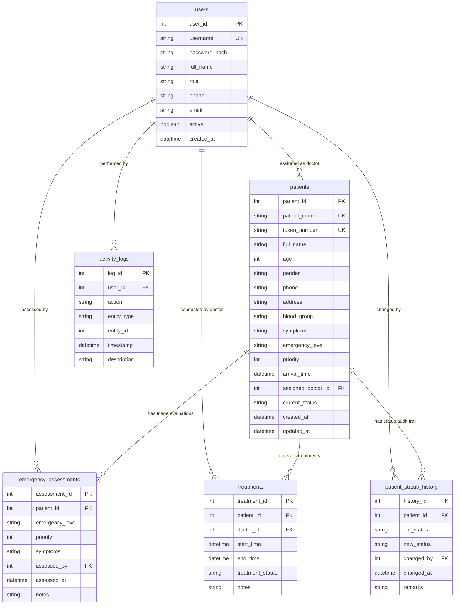

# Relational Database Design Document

## Hospital Emergency Patient Priority Management System (HE-PPMS)

### 1. Database Specifications
- **Database Engine**: MySQL 8.0+ (InnoDB Storage Engine)
- **Character Set**: `utf8mb4`
- **Collation**: `utf8mb4_unicode_ci`
- **Default Database Name**: `hospital_emergency_system`
- **Normalization Level**: Third Normal Form (3NF)

---

### 2. Entity-Relationship Diagram (ERD)

---

### 3. Detailed Table Schema Definitions

#### 3.1. Table: `users`
Stores authorized healthcare personnel accounts with role permissions and BCrypt credential hashes.

| Column | Type | Constraints | Description |
| :--- | :--- | :--- | :--- |
| `user_id` | `INT` | `AUTO_INCREMENT, PRIMARY KEY` | Unique surrogate key |
| `username` | `VARCHAR(50)` | `NOT NULL, UNIQUE` | Unique login handle |
| `password_hash` | `VARCHAR(255)` | `NOT NULL` | BCrypt salted hash |
| `full_name` | `VARCHAR(100)` | `NOT NULL` | Full professional title & name |
| `role` | `ENUM` | `NOT NULL` | `'ADMIN'`, `'DOCTOR'`, `'NURSE'` |
| `phone` | `VARCHAR(20)` | `NULL` | Contact phone number |
| `email` | `VARCHAR(100)` | `NULL` | Hospital email address |
| `active` | `BOOLEAN` | `DEFAULT TRUE` | Soft deletion / activation flag |
| `created_at` | `DATETIME` | `DEFAULT CURRENT_TIMESTAMP` | Account provisioning timestamp |

#### 3.2. Table: `patients`
Central emergency intake registry capturing demographic details, emergency triage level, priority, arrival time, and current workflow status.

| Column | Type | Constraints | Description |
| :--- | :--- | :--- | :--- |
| `patient_id` | `INT` | `AUTO_INCREMENT, PRIMARY KEY` | Internal surrogate key |
| `patient_code` | `VARCHAR(20)` | `NOT NULL, UNIQUE` | Hospital patient code (e.g. `P0001`) |
| `token_number` | `VARCHAR(20)` | `NOT NULL, UNIQUE` | Emergency ticket token (e.g. `ER-001`) |
| `full_name` | `VARCHAR(100)` | `NOT NULL` | Patient full legal name |
| `age` | `INT` | `NOT NULL` | Patient age (0–130) |
| `gender` | `VARCHAR(10)` | `NOT NULL` | `'Male'`, `'Female'`, `'Other'` |
| `phone` | `VARCHAR(20)` | `NOT NULL` | Contact phone number |
| `address` | `TEXT` | `NULL` | Residential address |
| `blood_group` | `VARCHAR(10)` | `NULL` | Blood type (e.g. `O+`, `A-`) |
| `symptoms` | `TEXT` | `NOT NULL` | Chief clinical complaint |
| `emergency_level` | `VARCHAR(20)` | `NOT NULL` | `'CRITICAL'`, `'HIGH'`, `'MEDIUM'`, `'LOW'` |
| `priority` | `INT` | `NOT NULL` | Priority number: 1, 2, 3, or 4 |
| `arrival_time` | `DATETIME` | `NOT NULL` | Triage arrival timestamp |
| `assigned_doctor_id` | `INT` | `NULL, FK -> users(user_id)` | Primary attending physician |
| `current_status` | `VARCHAR(20)` | `DEFAULT 'WAITING'` | Workflow state |
| `created_at` | `DATETIME` | `DEFAULT CURRENT_TIMESTAMP` | Record creation time |
| `updated_at` | `DATETIME` | `ON UPDATE CURRENT_TIMESTAMP` | Last modification time |

**Indexes**:
- `idx_priority_arrival (priority, arrival_time)`: High-performance composite index powering the Priority Queue query.
- `idx_current_status (current_status)`: Filters waiting vs. discharged cases.
- `idx_patient_code (patient_code)` & `idx_token_number (token_number)`: Instant lookups.

#### 3.3. Table: `emergency_assessments`
Clinical audit logs of triage evaluations conducted by medical staff.

| Column | Type | Constraints | Description |
| :--- | :--- | :--- | :--- |
| `assessment_id` | `INT` | `AUTO_INCREMENT, PRIMARY KEY` | Evaluation ID |
| `patient_id` | `INT` | `NOT NULL, FK -> patients` | Referenced patient |
| `emergency_level` | `VARCHAR(20)` | `NOT NULL` | Assigned severity level |
| `priority` | `INT` | `NOT NULL` | Priority score (1-4) |
| `symptoms` | `TEXT` | `NOT NULL` | Evaluation symptoms |
| `assessed_by` | `INT` | `NOT NULL, FK -> users` | Staff user who triaged |
| `assessed_at` | `DATETIME` | `DEFAULT CURRENT_TIMESTAMP` | Evaluation timestamp |
| `notes` | `TEXT` | `NULL` | Triage notes & findings |

#### 3.4. Table: `treatments`
Tracks interventions, procedures, observations, and care completion.

| Column | Type | Constraints | Description |
| :--- | :--- | :--- | :--- |
| `treatment_id` | `INT` | `AUTO_INCREMENT, PRIMARY KEY` | Treatment ID |
| `patient_id` | `INT` | `NOT NULL, FK -> patients` | Patient receiving care |
| `doctor_id` | `INT` | `NOT NULL, FK -> users` | Attending physician |
| `start_time` | `DATETIME` | `NOT NULL` | Commencement time |
| `end_time` | `DATETIME` | `NULL` | Completion / discharge time |
| `treatment_status` | `VARCHAR(50)` | `DEFAULT 'IN_PROGRESS'` | `'IN_PROGRESS'`, `'COMPLETED'` |
| `notes` | `TEXT` | `NULL` | Clinical care & medication notes |

#### 3.5. Table: `patient_status_history`
Immutable audit trail recording every workflow status transition.

| Column | Type | Constraints | Description |
| :--- | :--- | :--- | :--- |
| `history_id` | `INT` | `AUTO_INCREMENT, PRIMARY KEY` | History ID |
| `patient_id` | `INT` | `NOT NULL, FK -> patients` | Target patient |
| `old_status` | `VARCHAR(20)` | `NULL` | Status prior to change |
| `new_status` | `VARCHAR(20)` | `NOT NULL` | Updated status |
| `changed_by` | `INT` | `NOT NULL, FK -> users` | Healthcare worker responsible |
| `changed_at` | `DATETIME` | `DEFAULT CURRENT_TIMESTAMP` | Transition timestamp |
| `remarks` | `TEXT` | `NULL` | Justification or transfer notes |

#### 3.6. Table: `activity_logs`
System-wide activity logger for operational auditing.

| Column | Type | Constraints | Description |
| :--- | :--- | :--- | :--- |
| `log_id` | `INT` | `AUTO_INCREMENT, PRIMARY KEY` | Log ID |
| `user_id` | `INT` | `NULL, FK -> users` | Operating user |
| `action` | `VARCHAR(50)` | `NOT NULL` | Action code (e.g. `LOGIN`, `PATIENT_REGISTERED`) |
| `entity_type` | `VARCHAR(50)` | `NULL` | Target domain entity |
| `entity_id` | `INT` | `NULL` | Target entity identifier |
| `timestamp` | `DATETIME` | `DEFAULT CURRENT_TIMESTAMP` | Occurrence timestamp |
| `description` | `TEXT` | `NULL` | Human-readable log narrative |
